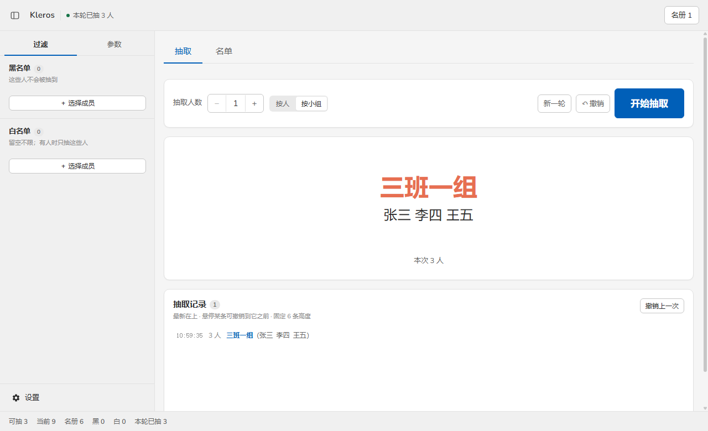
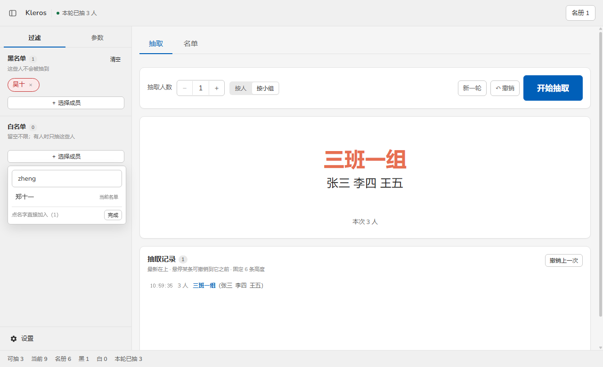
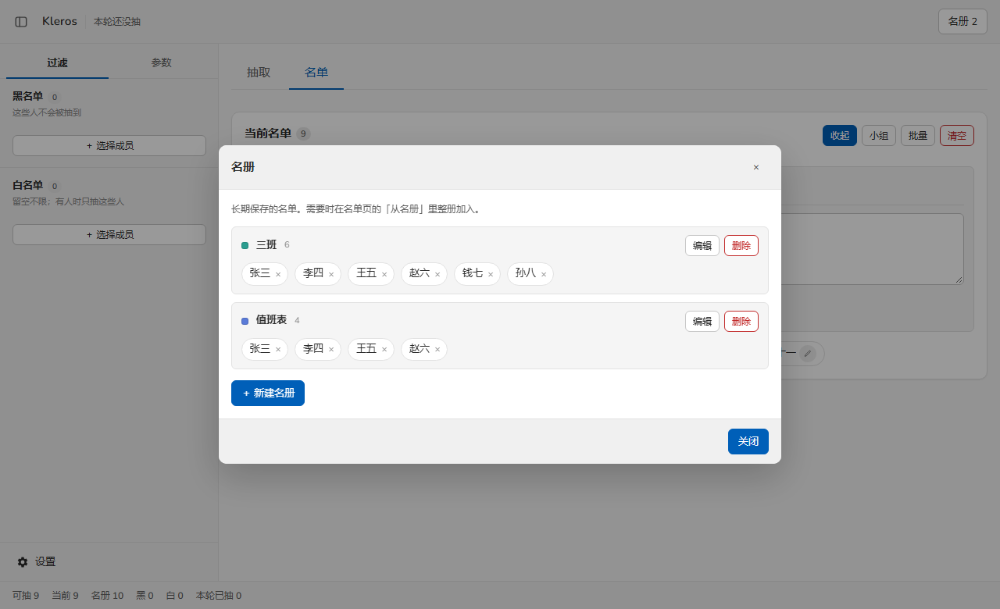

# Kleros · 点名器

Kleros 是一个用于随机指派的单文件工具。把名单放进来，按人或按小组抽取，本轮抽中的人不会重复出现。

无需注册，无需联网，数据全部保存在浏览器本地。构建产物只有一个 HTML 文件，双击即可运行。

<p align="center">
  
</p>

## 功能

### 两种抽取口径

**按人**：每个人独立参与，抽几个人就出几个人。

**按小组**：事先编好的组被视为一个整体，组内成员一起被抽中，不会被拆开。名额不足时整组一起出——设 2 人却抽中 3 人小组，结果就是 3 个人。

按小组抽取时，不属于任何小组的人不参与，「可抽 N 人」也只统计组内成员。

### 黑白名单

黑名单中的人不会出现在抽取结果里。白名单一旦有内容，抽取范围就缩小到白名单内。

两个名单的搜索框都支持拼音：输入 `zs` 或 `zhangsan` 都能找到「张三」，大小写不敏感。

<p align="center">
  
</p>

### 名册

名册用于长期保存名单，与当前参与抽取的名单分离。常用的班级、值班表放进名册后，可以整册或按人重新加入当前名单。

<p align="center">
  
</p>

### 其他

- **滚动动画**：名字滚动若干秒后定格，速度可调，空格键控制开始与暂停
- **抽取记录**：本轮每次抽取都有记录，可撤销到任意一条之前
- **界面**：深色模式；分页、左右分栏、上下堆叠三种布局
- **数据**：支持 JSON 导入导出

## 快速开始

```bash
npm install
npm run dev      # 开发服务器，http://localhost:5173
```

构建可分发版本：

```bash
npm run build    # 输出 dist/Kleros <版本>.html，双击即可运行
```

## 使用

1. 在「名单」页添加人员。支持批量粘贴（空格、逗号、换行、制表符均可分隔）、逐个添加、读取 `.txt` / `.csv`，或从名册导入。
2. 如需按小组抽取，在名单页点击「小组」，勾选至少两人建立分组。
3. 在「抽取」页选择口径与人数，点击开始。抽完可以撤销，或开新一轮重置。
4. 侧栏「过滤」维护黑白名单，「参数」调整本轮不重复、自动换轮等行为。

## 数据存储

数据保存在浏览器的 IndexedDB 中，不上传、不联网。

以 `file://` 方式直接打开 HTML 时，数据与文件路径绑定——移动文件位置会导致数据不可见。清除浏览器数据也会一并清除。重要名单建议在设置中导出 JSON 备份。

## 开发

Vue 3 + Vite + TypeScript，未使用 UI 框架，样式手写。需要 Node 18 及以上。

```bash
npm run dev     # 开发服务器，http://localhost:5173
npm run build   # 类型检查 + 构建，输出 dist/Kleros <版本>.html
```

构建产物名中的版本号读取自 `package.json`，无需另行修改。

拼音字典是预生成后写入源码的（`src/utils/pinyinDict.ts`），修改生成脚本 `scripts/gen-pinyin-dict.mjs` 后需重新执行：

```bash
node scripts/gen-pinyin-dict.mjs
```

## 目录结构

```
src/
├── components/     界面组件：面板、弹窗、抽取舞台
├── composables/    状态与业务逻辑
│   ├── useRoster.ts           当前名单
│   ├── usePermanentRoster.ts  名册（分组）
│   ├── useBundles.ts          小组
│   ├── useBlackWhiteList.ts   黑白名单
│   ├── useSession.ts          本轮状态与抽取记录
│   ├── usePicker.ts           抽取流程
│   └── useDB.ts               IndexedDB 持久化
├── utils/          纯函数：抽取算法、拼音、名单解析、导入导出
├── types/          TypeScript 类型定义
└── assets/styles/  base / layout / components 三段样式
```

## 实现说明

**成员以名字为唯一标识。** 名单、名册、小组之间都按名字匹配，不依赖内部 ID。改名会同步到小组；名单清空后重新加回同名的人，小组会自动恢复。

**抽取使用 Fisher-Yates 洗牌。** 洗一遍取前 N 个，剩余顺序同样随机，不是对随机数排序。

**抽签的最小单位是「签」。** 一个小组是一签，一个人也是一签，按签洗牌后再展开成员。

---

各版本的变更记录见 `docs/updates/`。
